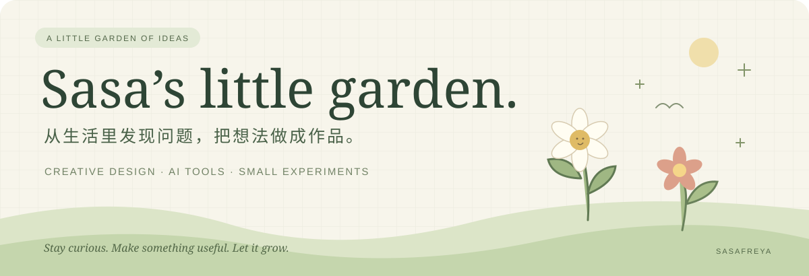

  

  <b>Hi, I'm Sasa / Jingwen 🌱</b> 
  文科背景的创作者，在设计、传播与 AI 之间探索。 
  A creative mind building useful little things with AI.

  <a href="https://sasafreya.github.io/feiyue-video-tools/">🎬 飞跃视频工具</a> &nbsp; · &nbsp;
  <a href="https://sasafreya.github.io/feiyue-planner/">📒 飞跃日程规划本</a> &nbsp; · &nbsp;
  <a href="https://github.com/SasaFreya?tab=repositories">🌿 全部作品</a>

---

### 01 / 关于我 · A little about me

我从英语翻译、数字营销走向创意设计，也开始用 AI 和代码，把工作与生活里反复遇到的问题做成小工具。

- **创意与传播**：关注出海广告、内容本地化，以及 AI 如何参与创意生产。
- **工具与工作流**：把视频包装、日程安排中的重复操作，整理成更顺手的产品。
- **故事与体验**：喜欢有温度的交互，也尝试把文字、音乐和成长故事放进游戏。

### 02 / 正在生长的作品 · Selected work

<table>
<tr>
<td width="50%" valign="top">
<h3>🎬 飞跃视频工具</h3>

<b>把重复的视频包装留给工具。</b>

在电脑本地批量改尺寸、换背景、加 Logo、水印与落版；保存方案，规范命名，一组素材输出多套包装。

视频工作流 · 本地处理 · macOS / Windows

<a href="https://sasafreya.github.io/feiyue-video-tools/">体验与下载 ↗</a> · <a href="https://github.com/SasaFreya/feiyue-video-tools">项目介绍</a>

</td>
<td width="50%" valign="top">
<h3>📒 飞跃日程规划本</h3>

<b>把一年放在眼前，把今天一件件完成。</b>

从纸本式年、月、周规划，到桌面悬浮清单、项目日历与真实计时，也给随想留一点空白。

效率工具 · 纸本体验 · macOS Apple Silicon

<a href="https://sasafreya.github.io/feiyue-planner/">体验与下载 ↗</a> · <a href="https://github.com/SasaFreya/feiyue-planner">源码与说明</a>

</td>
</tr>
<tr>
<td width="50%" valign="top">
<h3>🌈 Town Girl Game</h3>

<b>Her town, her game, her way.</b>

把生活记录变成故事关卡，用哼唱驱动彩虹跑酷。一个关于女孩成长、音乐与回应的浏览器游戏 Demo。

SheNicest 2026 黑客松 · 叙事游戏 · Web Audio

<a href="https://github.com/SasaFreya/town-girl-game">走进这个故事 ↗</a>

</td>
<td width="50%" valign="top">
<h3>✍️ CATTI 笔译精析提示词</h3>

<b>让语言学习有迹可循。</b>

把笔译学习中的分析方法整理成可复用的提示词，连接语言背景与 AI 辅助学习。

翻译学习 · Prompt Design · CC BY 4.0

<a href="https://github.com/SasaFreya/catti-translation-prompt">阅读与使用 ↗</a>

</td>
</tr>
</table>

🍃 花园里的其他实验

- [东野市](https://github.com/SasaFreya/higashino-city)：用 Three.js 探索东野圭吾的叙事宇宙。
- [暴打某某某](https://github.com/SasaFreya/bao-da-moumou)：卡通击飞与大炮破坏玩法 Demo，尝试 Godot 4 与浏览器交互。

### 03 / 我的工具箱 · Working with

**创作** &nbsp; 广告设计 / 视频制作 / 内容本地化 / ComfyUI 工作流  
**搭建** &nbsp; AI 辅助开发 / Python / TypeScript / React / Next.js  
**探索** &nbsp; AI × 传播 / 创意自动化 / 叙事交互 / 个人效率工具

### 04 / 想继续做的事 · Growing toward

让创意更容易被实现，也让工具更贴近日常生活。持续从真实场景出发，把一次解决问题的经验，做成别人也能用的作品。

如果你也在做创意工具、AI 工作流或有趣的交互，欢迎在对应项目的 **Issues** 里交流。

---

🌱 一点好奇，一点行动，慢慢长出自己的花园。 Made with curiosity, care, and a little help from AI.

